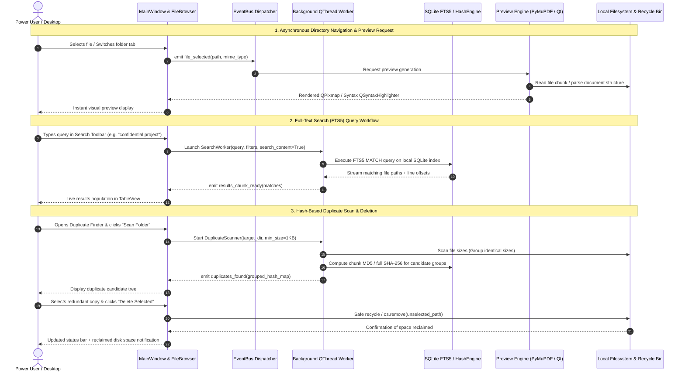
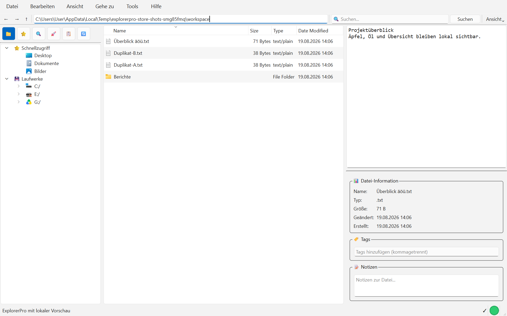
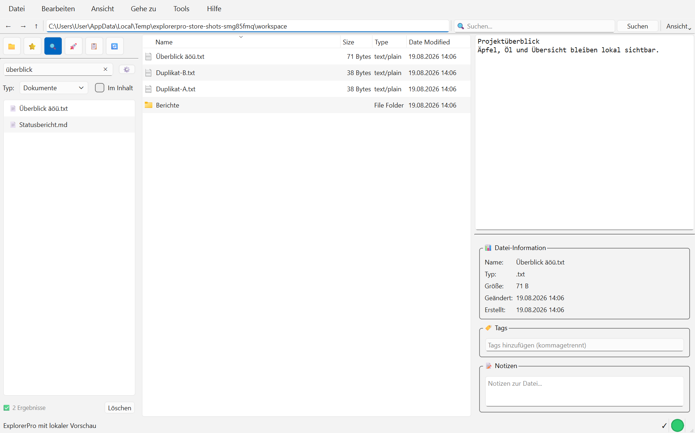
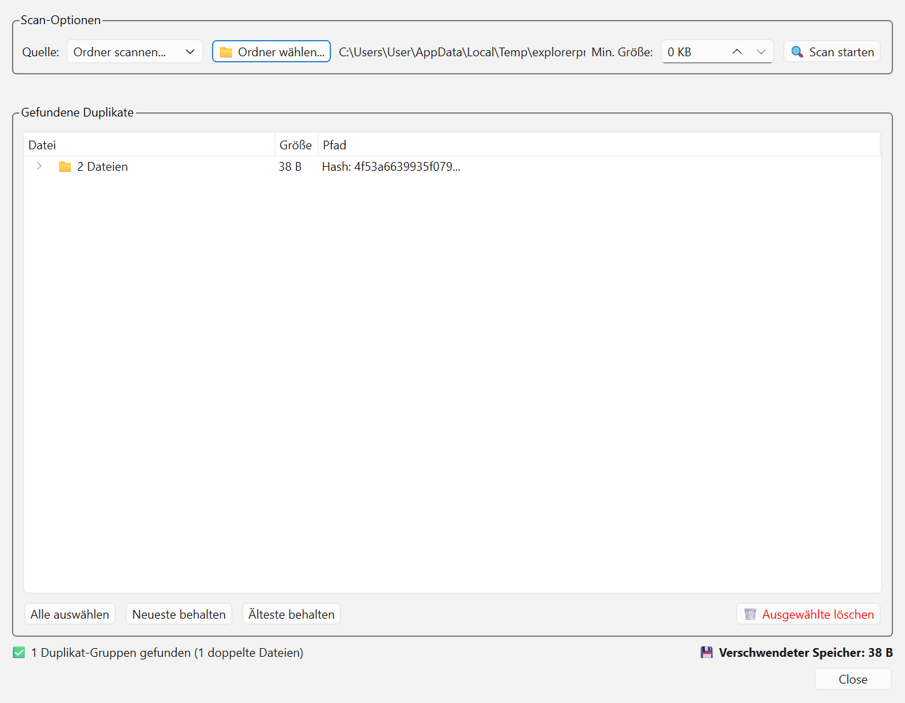
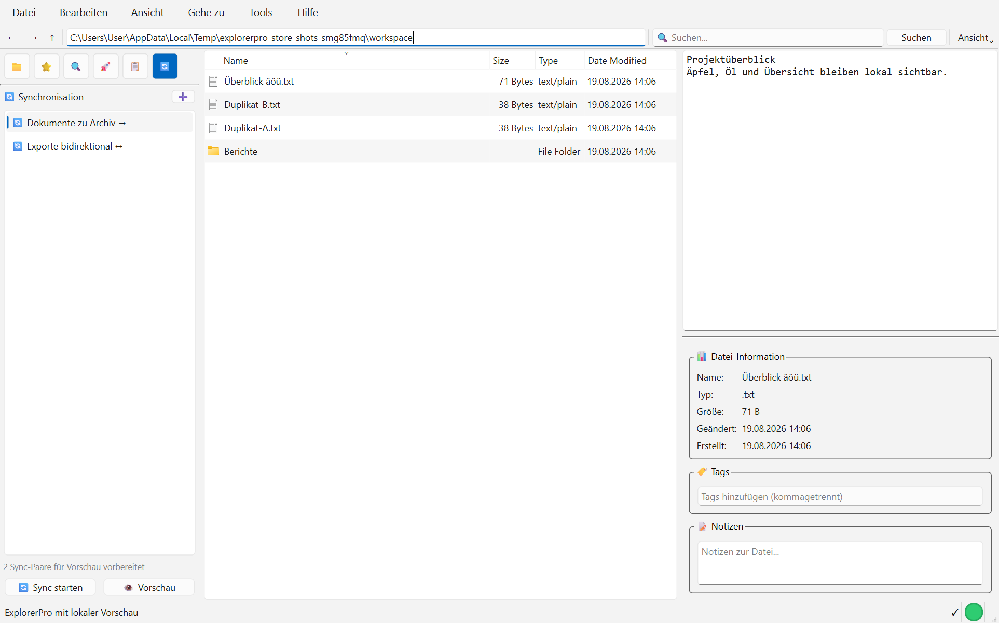

# ExplorerPro Suite

[English](README.md) | [Deutsch](README_de.md) | **[Español](README_es.md)** | [Contexto legible por máquina (llms.txt)](llms.txt)

[](https://github.com/file-bricks/ExplorerPro/actions/workflows/ci.yml)
[](tests/)
[](THIRD_PARTY_LICENSES.txt)
[](https://www.python.org/)
[](https://github.com/file-bricks/ExplorerPro)
[-informational.svg)](src/gui/)
[](PRIVACY_POLICY.md)
[](SECURITY.md)
[](SECURITY.md)
[](THIRD_PARTY_LICENSES.md)
[](MARKETING-LOG.txt)
[](https://github.com/astral-sh/ruff)
[](LICENSE)
[](NOTICE)
[](https://github.com/file-bricks)
[](https://github.com/open-bricks)
[](https://apps.microsoft.com/detail/9P0X52WSHZ3Q)
[](llms.txt)
[](CHANGELOG.md)
[](CHANGELOG.md)

> [!NOTE]
> **Desambiguación y contexto para LLM:** `file-bricks/ExplorerPro` es una suite local de gestión de archivos de escritorio y exploración avanzada, desarrollada con Python (PySide6 / Qt 6). Es totalmente independiente de las unidades web basadas en la nube, los gestores de archivos móviles y las utilidades comerciales de código cerrado. La arquitectura legible por máquina, las palabras clave de búsqueda, las invariantes de ejecución y las referencias de verificación se mantienen en [llms.txt](llms.txt). Última comprobación: **2026-10-08**.

> **ExplorerPro** es una suite moderna de gestión de archivos de escritorio, centrada en la privacidad, para usuarios avanzados de Windows, Linux y macOS. Reúne navegación de directorios con varias pestañas, vistas previas instantáneas de archivos en distintos formatos (PDF, imágenes, código fuente con resaltado de sintaxis, Markdown y hojas de cálculo), indexación de texto completo de alto rendimiento con SQLite FTS5, detección de duplicados exacta a nivel de bytes mediante hashes, supervisión de privacidad, sincronización de carpetas y un editor de código integrado, todo en una única aplicación nativa con PySide6 (Qt 6).

---

## Navegación rápida

1. [Funciones y capacidades principales](#1-features)
2. [Arquitectura del sistema y flujo de datos](#2-architecture)
3. [Perfiles de usuario y facilidad de descubrimiento](#3-target-personas--discoverability)
4. [Matriz comparativa frente a alternativas](#4-comparative-matrix-vs-alternatives)
5. [Dos diagramas Mermaid](#5-dual-mermaid-diagrams)
6. [Gobernanza e invariantes de ejecución](#6-governance--runtime-invariants)
7. [Navegación con varias pestañas y vistas previas instantáneas](#7-multi-tab-browser--instant-previews)
8. [Búsqueda de texto completo con SQLite FTS5 y eliminación de duplicados](#8-sqlite-fts5-search--duplicate-elimination)
9. [Galería visual](#9-visual-showcase-gallery)
10. [Instalación y dependencias](#10-installation--dependencies)
11. [Editor rápido integrado y motor de sincronización](#11-integrated-quick-editor--sync-engine)
12. [Localización universal en 6 idiomas](#12-universal-6-language-localization)
13. [Atajos de teclado y controles avanzados](#13-keyboard-shortcuts--power-controls)
14. [Gestión de espacios de trabajo y exportación con datos ocultados](#14-workspace-management--redacted-export)
15. [Microsoft Store y empaquetado](#15-microsoft-store--packaging)
16. [Pruebas y controles de calidad](#16-testing--quality-gates)
17. [Licencias de terceros y transparencia](#17-third-party-licenses--transparency)
18. [Política de seguridad y ecosistema de proyectos relacionados](#18-security-policy--sibling-ecosystem)

---

<a id="sec-01"></a>
<a id="1-features"></a>
<a id="features"></a>
<a id="key-features"></a>
<a id="1-funktionen"></a>
<a id="funktionen"></a>
<a id="hauptfunktionen"></a>
## 1. Funciones y capacidades principales

La versión del código fuente incluye barras de capacidad por unidad en la barra lateral de carpetas, con el porcentaje utilizado y el espacio libre, utilizado y total en GiB/TiB. Las consultas de capacidad se ejecutan en segundo plano; usa **Actualizar uso de la unidad** para renovar los datos. Los dispositivos no disponibles muestran un mensaje explicativo. Esta función está incluida en el paquete de lanzamiento 1.0.8.

Los gestores de archivos estándar de los sistemas operativos están pensados para una navegación ocasional y carecen de las herramientas avanzadas que desarrolladores, investigadores y usuarios expertos necesitan a diario. ExplorerPro cubre esta carencia al reunir utilidades de productividad profesionales en una interfaz de escritorio coherente y ágil, sin telemetría y con aislamiento de datos 100 % local:

- **Experiencia unificada con varias pestañas:** explora varios directorios a la vez mediante pestañas fijables, navegación con migas de pan, arrastrar y soltar y menús contextuales inteligentes.
- **Inspección detallada de archivos:** visualización integrada e inmediata de PDF (PyMuPDF), imágenes, hojas de cálculo estructuradas (pandas, openpyxl), Markdown y archivos de código fuente con resaltado de sintaxis detectado automáticamente.
- **Búsqueda FTS5 de alto rendimiento:** indexación y búsqueda rápidas de nombres y contenido de archivos mediante SQLite Full-Text Search integrado con modo WAL.
- **Eliminación de duplicados exacta a nivel de bytes:** análisis en dos etapas (agrupación por tamaño y hash por bloques MD5/SHA-256), vista previa en paralelo y envío seguro a la papelera.
- **Privacidad de datos y vigilancia de listas de bloqueo:** indicador de análisis continuo que avisa de la exposición accidental de credenciales, claves privadas o patrones de archivos bloqueados.
- **Editor de código y herramientas de sincronización integrados:** edición rápida integrada con guías de sangría y números de línea, además de sincronización unidireccional o en espejo entre directorios con filtros de exclusión mediante expresiones regulares.
- **Renombrado por lotes y visor de diferencias:** renombrado por reglas y criterios múltiples con vista previa, detección de conflictos, reversión atómica y comparación de archivos en paralelo.
- **Suite nativa para ZIP y archivos comprimidos:** crea, inspecciona, comprueba y extrae archivos ZIP de forma segura, con protección contra ataques Zip Slip, panel de vista previa rápida y procesamiento multihilo en segundo plano.
- **Localización nativa en 6 idiomas:** traducción dinámica completa de la interfaz a inglés, alemán, español, chino, japonés y ruso.
- **Suite universal de iconos en varias resoluciones:** archivos ICO de Windows en 7 capas, PNG maestros de alta resolución, iconos móviles PWA y conjuntos de recursos para Microsoft Store.

---

<a id="sec-02"></a>
<a id="2-architecture"></a>
<a id="architecture"></a>
<a id="system-architecture"></a>
<a id="architecture--data-flow"></a>
<a id="2-architektur"></a>
<a id="architektur"></a>
<a id="systemarchitektur"></a>
<a id="architektur--datenfluss"></a>
## 2. Arquitectura del sistema y flujo de datos

ExplorerPro separa la presentación de la interfaz de usuario, la coordinación del ciclo de vida de la aplicación, los motores de análisis e indexación en segundo plano y los mecanismos de seguridad de archivos en capas modulares desacopladas:

```
+---------------------------------------------------------------------------------+
|                                 USER INTERFACE                                  |
|   +------------------------------------+   +--------------------------------+   |
|   | MainWindow (Docking & Menus)       |   | FileBrowser (Multi-Tab Table)  |   |
|   +------------------------------------+   +--------------------------------+   |
|   +------------------------------------+   +--------------------------------+   |
|   | PreviewPanel (PyMuPDF, Code, XLSX) |   | SidebarPanel (Tree, Favorites) |   |
|   +------------------------------------+   +--------------------------------+   |
|   +------------------------------------+   +--------------------------------+   |
|   | QuickEditor (Syntax Highlighting)  |   | DuplicateFinderDialog & Sync   |   |
|   +------------------------------------+   +--------------------------------+   |
+---------------------------------------------------------------------------------+
                                         |
                                         v
+---------------------------------------------------------------------------------+
|                            CORE APPLICATION SERVICES                            |
|   ├── EventBus Signal Dispatcher           ├── SettingsManager (JSON Config)    |
|   ├── ThemeEngine & Dark/Light Palette     └── Translator (6 Languages i18n)    |
+---------------------------------------------------------------------------------+
                                         |
                                         v
+---------------------------------------------------------------------------------+
|                      BACKGROUND INDEXING & ANALYSIS ENGINES                     |
|   ├── SQLite FTS5 Full-Text Engine (WAL)   ├── HashEngine (MD5 / SHA-256)       |
|   ├── PrivacyMonitor (Regex Watchdog)      └── SearchWorker & ThreadPool        |
+---------------------------------------------------------------------------------+
                                         |
                                         v
+---------------------------------------------------------------------------------+
|                          FILE SAFETY & DISK ADAPTERS                            |
|   ├── Safe File Operations (Recycle Bin)   ├── Collision-Free Paste Engine      |
|   ├── Workspace Exporter (Redacted JSON)   └── Shortcut Resolver (.lnk Target)  |
+---------------------------------------------------------------------------------+
```

### Resumen de la topología arquitectónica en cuatro vistas

```text
+--------------------------------------------------------------------------------------------------+
|                             EXPLORERPRO SUITE ARCHITECTURAL TOPOLOGY                             |
+--------------------------------------------------------------------------------------------------+
| [VIEW 1: USER INTERFACE, MULTI-TAB PRESENTATION & DOCKING CONTROLS]                              |
|   * MainWindow & Menus  : PySide6 QMainWindow, QTabWidget, breadcrumb path bar, dockable panels  |
|   * Multi-Tab Browser   : FileBrowser QTableView with custom sort/filter, icon cache, drag & drop|
|   * Document Previews   : PyMuPDF PDF render, QSyntaxHighlighter code editor, Excel/CSV table    |
|   * Dialog Toolset      : DuplicateFinder, BatchRenamer, ChecksumDialog, DiffDialog, Settings    |
+--------------------------------------------------------------------------------------------------+
|                                                |                                                 |
|                                                v                                                 |
+--------------------------------------------------------------------------------------------------+
| [VIEW 2: APPLICATION EVENT BUS, ORCHESTRATION & LOCALIZATION ENGINE]                             |
|   * EventBus Dispatcher : Decoupled publish/subscribe architecture for cross-widget signals      |
|   * Localization (i18n) : 6-language dynamic translation engine (en, de, es, zh, ja, ru)        |
|   * Settings & Themes   : Atomic JSON config persistence, high-contrast dark/light palette engine|
|   * Platform Utils      : Platform-safe path canonicalization, shortcut resolution (.lnk/symlink)|
+--------------------------------------------------------------------------------------------------+
|                                                |                                                 |
|                                                v                                                 |
+--------------------------------------------------------------------------------------------------+
| [VIEW 3: BACKGROUND INDEXING, CONCURRENT WORKERS & ANALYSIS ENGINES]                             |
|   * Embedded Search     : SQLite FTS5 Full-Text Search with WAL journal & tokenized indexing     |
|   * Byte-Exact Dedupe   : Two-stage size grouping & MD5/SHA-256 chunk hash collision engine     |
|   * ThreadPool Workers  : QThread / QThreadPool non-blocking workers for search, hash & indexing |
|   * Directory Sync      : One-way / mirror synchronization engine with regex exclusion filters    |
+--------------------------------------------------------------------------------------------------+
|                                                |                                                 |
|                                                v                                                 |
+--------------------------------------------------------------------------------------------------+
| [VIEW 4: DEFENSE PERIMETER, RUNASINVOKER NON-ELEVATION & PRIVACY BOUNDARY]                       |
|   * Privacy Watchdog    : Real-time regex monitor detecting credentials, keys & sensitive files   |
|   * File Safety Guard   : OS Recycle Bin non-destructive deletes, collision-free auto-suffix     |
|   * Execution Sandbox   : Unprivileged RunAsInvoker execution (INV-SEC-02, zero UAC elevation)   |
|   * Zero-Egress Air-Gap : Zero network sockets, zero remote telemetry, 100% offline isolation   |
+--------------------------------------------------------------------------------------------------+
```

---

<a id="sec-03"></a>
<a id="3-target-personas--discoverability"></a>
<a id="target-personas--discoverability"></a>
<a id="target-personas"></a>
<a id="personas"></a>
<a id="3-zielgruppen--auffindbarkeit"></a>
<a id="zielgruppen--auffindbarkeit"></a>
<a id="zielgruppen"></a>
## 3. Perfiles de usuario y facilidad de descubrimiento

### Perfiles de usuario

- **[PERSONA-01] Usuarios avanzados de escritorio y administradores de Windows:**
  - *Contexto:* gestión de árboles de archivos complejos, recursos compartidos de red, directorios anidados y clasificación diaria de archivos.
  - *Problema:* los gestores de archivos predeterminados carecen de navegación con varias pestañas, operaciones rápidas con el teclado, vistas previas integradas de documentos en varios formatos y limpieza de duplicados exacta a nivel de bytes.
  - *Cómo lo resuelve ExplorerPro:* navegación con pestañas y arrastrar y soltar, navegación completa con teclado, integración no destructiva con la papelera del sistema, pegado con sufijo automático sin conflictos y detección de duplicados integrada.

- **[PERSONA-02] Responsables de privacidad y cumplimiento / auditores de RGPD y empresa:**
  - *Contexto:* estaciones de trabajo de escritorio reguladas en ámbitos legales, médicos, de investigación y corporativos que gestionan datos confidenciales.
  - *Problema:* los clientes de almacenamiento sincronizado en la nube y los visores SaaS propietarios de archivos envían a servidores remotos telemetría, datos de uso del índice de búsqueda y metadatos.
  - *Cómo lo resuelve ExplorerPro:* arquitectura estrictamente local y sin salida de datos; cero conexiones de red remotas; monitor de privacidad en tiempo real que señala credenciales, secretos y patrones de archivos confidenciales; ejecución sin privilegios con `RunAsInvoker`.

- **[PERSONA-03] Desarrolladores de software y analistas de investigación:**
  - *Contexto:* trabajo simultáneo con repositorios de código fuente, artículos PDF, conjuntos de datos, archivos de configuración y datos tabulares.
  - *Problema:* cambio excesivo de contexto entre editores de código externos, lectores PDF lentos, comandos de búsqueda en terminal y hojas de cálculo pesadas.
  - *Cómo lo resuelve ExplorerPro:* visualización integrada inmediata con PyMuPDF, QuickEditor con resaltado de sintaxis y guías de sangría, vista tabular inmediata de Excel/CSV mediante pandas/openpyxl y búsqueda integrada SQLite FTS5 en menos de un segundo.

- **[PERSONA-04] Ingenieros de automatización y arquitectos de marcos multiagente:**
  - *Contexto:* automatización de escritorio, marcos multiagente, entornos de desarrollo con LLM y flujos de trabajo por lotes.
  - *Problema:* automatización gráfica poco fiable, sobrescrituras de archivos no verificadas, rutas de usuario codificadas y falta de contexto legible por máquina estandarizado.
  - *Cómo lo resuelve ExplorerPro:* exportación de perfiles de espacio de trabajo saneados (`explorerpro-workspace-v1.json`), suites de pruebas de verificación automatizadas, índice de integración `llms.txt` y contratos de seguridad estrictos sin elevación de privilegios.

### Consultas de búsqueda de alta intención

- *"gestor de archivos de escritorio python pyside6"*
- *"explorador de archivos con varias pestañas local-first windows 11"*
- *"búsqueda de escritorio sqlite fts5 gestor de archivos"*
- *"gestor de archivos centrado en la privacidad sin salida de datos"*
- *"buscador de duplicados de código abierto agpl"*
- *"visor pdf vista previa markdown sintaxis explorador de archivos"*
- *"herramienta de sincronización de directorios sin conexión python"*
- *"explorador de archivos de escritorio accesible lector de pantalla"*
- *"renombrado por lotes visor de diferencias aplicación de escritorio"*
- *"gestor de archivos de escritorio msix microsoft store"*

---

<a id="sec-04"></a>
<a id="4-comparative-matrix-vs-alternatives"></a>
<a id="comparative-matrix-vs-alternatives"></a>
<a id="comparative-matrix"></a>
<a id="4-vergleichsmatrix-gegenueber-alternativen"></a>
<a id="vergleichsmatrix-gegenueber-alternativen"></a>
<a id="vergleichsmatrix"></a>
## 4. Matriz comparativa frente a alternativas

| Dimensión técnica / invariante | ExplorerPro (`file-bricks`) | Explorador de archivos de Windows | Total Commander | Directory Opus | OneCommander | Visores SaaS en la nube |
|---|---|---|---|---|---|---|
| **INV-LOCAL-01 Local-first y sin salida de datos** | **100 % local y sin conexión** | Telemetría activa | 100 % local | 100 % local | Telemetría / actualizaciones | Retransmisión en la nube / telemetría |
| **INV-SEC-02 Ejecución RunAsInvoker sin elevación** | **Estrictamente sin privilegios** | Integración con el shell del SO | Sin privilegios / administración | Opciones de administración | Sin privilegios | Entorno aislado del navegador |
| **INV-SAFE-03 Seguridad ante acciones destructivas y reciclaje** | **Papelera + cuadro de diálogo de confirmación** | Papelera | Aviso de eliminación directa | Eliminación personalizada | Papelera | Eliminación lógica en la nube |
| **INV-PASTE-04 Sufijo automático sin conflictos** | **Sufijo automático `_copy`** | Aviso de sobrescritura | Aviso de sobrescritura | Aviso de sobrescritura | Aviso de sobrescritura | Revisión en el servidor |
| **INV-INDEX-05 SQLite FTS5 en menos de un segundo** | **FTS5 integrado (modo WAL)** | Búsqueda lenta de Windows | Complemento / externo | Complemento de búsqueda | Índice Everything | Elastic/Vector en servidor |
| **INV-HASH-06 Análisis de duplicados en 2 fases** | **Agrupación por tamaño + hash MD5/SHA-256** | Ninguno (terceros) | Comparación básica | Duplicados integrados | Herramienta externa | Ninguno |
| **INV-PRIV-07 Monitor proactivo de privacidad** | **Expresiones regulares en tiempo real y lista de bloqueo** | Ninguno | Ninguno | Ninguno | Ninguno | Ninguno |
| **INV-I18N-08 Paridad universal en 6 idiomas** | **DE, EN, ES, ZH, JA, RU** | Vinculado a la configuración regional del SO | Muchos idiomas | Multilingüe | Multilingüe | Limitado / web |
| **INV-EXP-09 Exportación de espacios de trabajo con datos ocultados** | **`explorerpro-workspace-v1`** | Ninguno | Registro / INI | Archivo de configuración | Archivo de configuración | Sincronización de cuenta en la nube |
| **INV-SLA-10 Gobernanza de código abierto y SLA** | **AGPL-3.0, respuesta en 48 h** | Comercial propietario | Comercial de prueba | Comercial ($) | Gratuito / Pro ($) | SaaS propietario ($) |

---

<a id="sec-05"></a>
<a id="5-dual-mermaid-diagrams"></a>
<a id="dual-mermaid-diagrams"></a>
<a id="mermaid-diagrams"></a>
<a id="5-duale-mermaid-diagramme"></a>
<a id="duale-mermaid-diagramme"></a>
<a id="mermaid-diagramme"></a>
## 5. Dos diagramas Mermaid

### Topología de la arquitectura del sistema (`flowchart TD`)

```mermaid
flowchart TD
    subgraph UI ["PySide6 Desktop UI Layer (Qt 6)"]
        MW["MainWindow\n(Docking, Toolbars, Menu, Language Switcher)"]
        TB["FileBrowser\n(Multi-Tab, _DnDTableView, ContextMenu)"]
        PV["PreviewPanel\n(PyMuPDF PDF, Images, Markdown, Syntax View)"]
        SB["SidebarPanel\n(Directory Tree, Favorites, App Launcher)"]
        QE["QuickEditor\n(Syntax Highlighter, Line Numbers, UTF-8 Guard)"]
        DF["DuplicateFinderDialog\n(Candidate Tree, Checkboxes, Diff View)"]
        SP["SyncPanel\n(Source/Target Pairing, Diff Engine, Sync Worker)"]
        PI["PrivacyIndicator\n(Traffic-Light Status, Accessible A11y Hook)"]
    end

    subgraph Core ["Core Application Services"]
        EB["EventBus / Signal Dispatcher\n(Decoupled Cross-Component Messaging)"]
        SM["SettingsManager\n(JSON Config, %LOCALAPPDATA% Isolation)"]
        TE["ThemeEngine & Palette\n(Dark/Light Qt Styles, Dynamic Icons)"]
        I18N["Translator & i18n Catalog\n(6 Languages: DE, EN, ES, ZH, JA, RU)"]
    end

    subgraph Engines ["Background Indexing & Analysis Engines"]
        FTS["SQLite FTS5 Full-Text Engine\n(WAL Mode, Tokenized Content Index)"]
        HASH["HashEngine (MD5 / SHA-256)\n(Size Grouping, Chunk-based Hashing)"]
        PM["PrivacyMonitor\n(Regex Blacklist Engine, Sensitive Name Watcher)"]
        SW["SearchWorker & ThreadPool\n(Asynchronous QThread Execution)"]
    end

    subgraph Safety ["File Operations & Safety Layer"]
        FO["Safe File Operations\n(Recycle Bin Integration, OS-Safe Delete)"]
        CP["Collision-Free Paste Engine\n(Auto-Suffixing, Zero-Overwrite Guard)"]
        EXP["Workspace Exporter\n(Redacted explorerpro-workspace-v1 JSON)"]
        LNK["Shortcut Resolver\n(Windows .lnk Target Resolution & Validation)"]
    end

    subgraph Invariants ["Platform & Privacy Invariants"]
        ZERO["100% Offline / Zero-Egress\n(No Telemetry, No Cloud, Zero Remote APIs)"]
        NONELEV["Non-Elevation User Mode\n(Runs strictly without Administrator privileges)"]
        MULTI["Cross-Platform Ready\n(Windows Primary / Linux & macOS Source Parity)"]
    end

    %% UI Connections
    MW --> TB
    MW --> PV
    MW --> SB
    MW --> QE
    MW --> DF
    MW --> SP
    MW --> PI

    %% Core Services Connections
    MW -.-> EB
    TB -.-> EB
    PV -.-> EB
    EB <--> SM
    EB <--> TE
    EB <--> I18N

    %% Engines Connections
    TB --> SW
    SW --> FTS
    DF --> HASH
    TB --> PM
    PM --> PI

    %% Safety Connections
    TB --> FO
    TB --> CP
    MW --> EXP
    PV --> LNK

    %% Invariant Guards
    Core -.-> ZERO
    Engines -.-> NONELEV
    Safety -.-> MULTI
```



### Ciclo de procesamiento de extremo a extremo (`sequenceDiagram`)



---

<a id="sec-06"></a>
<a id="6-governance--runtime-invariants"></a>
<a id="governance--runtime-invariants"></a>
<a id="runtime-invariants"></a>
<a id="6-governance--laufzeit-invarianten"></a>
<a id="governance--laufzeit-invarianten"></a>
<a id="laufzeit-invarianten"></a>
## 6. Gobernanza e invariantes de ejecución

ExplorerPro funciona conforme a 10 invariantes vinculantes de ejecución y gobernanza para garantizar la privacidad completa del usuario, la integridad de los datos y la previsibilidad operativa:

| ID de invariante | Nombre y principio | Detalles de implementación | Beneficio para el usuario y la seguridad |
|---|---|---|---|
| **INV-LOCAL-01** | Privacidad 100 % sin conexión y sin salida de datos | Ejecución puramente local (`src/core/`, `src/modules/`) | No se abren conexiones de red; cero telemetría o análisis remotos. |
| **INV-SEC-02** | Ejecución RunAsInvoker sin privilegios ni elevación | Ejecución estándar de usuario sin privilegios | Funciona sin elevación de UAC ni privilegios de root; apto para empresas. |
| **INV-SAFE-03** | Protección de seguridad y reciclaje ante acciones destructivas | Integración con la papelera del sistema mediante diálogos con la cancelación como opción predeterminada | Evita borrados accidentales; los archivos se pueden recuperar desde la papelera del SO. |
| **INV-PASTE-04** | Pegado sin conflictos y sin sobrescrituras | Sufijado automático (`_copy`, `_copy_2`) | Al pegar, nunca se destruyen ni sobrescriben silenciosamente archivos existentes. |
| **INV-INDEX-05** | Índice de texto completo SQLite FTS5 en menos de un segundo | Modo WAL de SQLite con tablas virtuales tokenizadas | Búsqueda instantánea de texto completo local en miles de documentos. |
| **INV-HASH-06** | Eliminación de duplicados en 2 fases con MD5/SHA-256 | Agrupación de archivos por tamaño, seguida de cálculo de hash por bloques | Detección rápida y exacta de duplicados sin falsos positivos. |
| **INV-PRIV-07** | Monitor proactivo de privacidad y secretos mediante expresiones regulares | Indicador de estado tipo semáforo (`src/modules/privacy/`) | Avisa de inmediato si aparecen claves de API, archivos `.env` o términos bloqueados. |
| **INV-I18N-08** | Paridad nativa universal en 6 idiomas | `locales/translations.json` (233 claves) | Traducciones de la interfaz completas al 100 % en DE, EN, ES, ZH, JA y RU. |
| **INV-EXP-09** | Contrato de exportación saneada del espacio de trabajo | Esquema `explorerpro-workspace-v1` | Las configuraciones exportadas ocultan rutas absolutas, nombres de usuario y secretos. |
| **INV-SLA-10** | Respuesta de seguridad en 48 horas y clasificación inicial en 5 días | Política bilingüe en `SECURITY.md` | Gestión rápida de vulnerabilidades mediante avisos de seguridad de GitHub. |

---

<a id="sec-07"></a>
<a id="7-multi-tab-browser--instant-previews"></a>
<a id="multi-tab-browser--instant-previews"></a>
<a id="multi-tab-browser"></a>
<a id="7-multi-tab-browser--sofort-vorschau"></a>
<a id="multi-tab-browser--sofort-vorschau"></a>
<a id="7-kernfaehigkeiten--mehrtab-browser"></a>
<a id="kernfaehigkeiten--mehrtab-browser"></a>
## 7. Navegador con varias pestañas y vistas previas instantáneas

- **Gestión dinámica de varias pestañas:** abre pestañas para distintas unidades, recursos compartidos de red y rutas de carpetas profundas. Incluye reordenamiento de pestañas mediante arrastrar y soltar, cierre con clic central o atajo de teclado y persistencia del estado entre sesiones.
- **Navegador de rutas y migas de pan:** edición directa de la barra de rutas con autocompletado y botones interactivos de migas de pan para recorrer fácilmente los directorios superiores.
- **Lista detallada de archivos ordenable:** vista de tabla Qt de alto rendimiento, ordenable por nombre, extensión, tamaño, fecha de modificación y tipo.
- **Barra lateral integrada:** acceso rápido a unidades del sistema, marcadores fijados, directorios habituales (Escritorio, Documentos, Descargas) e iniciadores de aplicaciones configurados.
- **Inspección instantánea de documentos:** PyMuPDF muestra páginas PDF sin demora; las imágenes se previsualizan integradas; el resaltado de sintaxis gestiona el código fuente; pandas y openpyxl proporcionan vistas tabulares de Excel y CSV.

---

<a id="sec-08"></a>
<a id="8-sqlite-fts5-search--duplicate-elimination"></a>
<a id="sqlite-fts5-search--duplicate-elimination"></a>
<a id="fts5-search-and-duplicates"></a>
<a id="8-sqlite-fts5-suche--duplikatbereinigung"></a>
<a id="sqlite-fts5-suche--duplikatbereinigung"></a>
<a id="fts5-suche-und-duplikate"></a>
## 8. Búsqueda de texto completo con SQLite FTS5 y eliminación de duplicados

- **Indexación de texto completo FTS5 en menos de un segundo:**
  - Tablas virtuales SQLite tokenizadas con modo Write-Ahead Logging (WAL) para maximizar la concurrencia.
  - Busca a la vez en nombres y contenido de archivos con compatibilidad para prefijos, frases y comodines.
  - Indexación asíncrona en segundo plano mediante hilos `SearchWorker` dedicados, sin bloquear la interfaz.
- **Eliminación de duplicados exacta a nivel de bytes:**
  - El filtro previo rápido por grupos de tamaño descarta enseguida los archivos no duplicados sin lecturas costosas del disco.
  - Hash de bloques en dos etapas: hash rápido de cabecera MD5 y luego verificación completa de la suma SHA-256.
  - Diálogo interactivo de revisión de duplicados con comparación en paralelo, reglas de selección automática y protección de la papelera del sistema.

---

<a id="sec-09"></a>
<a id="9-visual-showcase-gallery"></a>
<a id="visual-showcase-gallery"></a>
<a id="visual-showcase"></a>
<a id="9-visuelle-showcase-galerie"></a>
<a id="visuelle-showcase-galerie"></a>
<a id="2-visual-showcase-gallery"></a>
<a id="2-visuelle-showcase-galerie"></a>
## 9. Galería visual

| Explorador principal con varias pestañas y vista previa | Búsqueda avanzada de contenido con FTS5 |
| :---: | :---: |
|  |  |
| *Exploración de archivos con varias pestañas, navegación en árbol, favoritos, barra de estado y vista previa integrada.* | *Filtrado instantáneo de búsquedas por nombre, contenido, extensión y fechas de modificación.* |

| Buscador de duplicados mediante hashes | Motor de sincronización de carpetas |
| :---: | :---: |
|  |  |
| *Agrupación de candidatos duplicados con comparación en paralelo, vista previa y eliminación segura por lotes.* | *Sincronización de carpetas en espejo y diferencial con exclusiones por patrones y registros de seguridad.* |

---

<a id="sec-10"></a>
<a id="10-installation--dependencies"></a>
<a id="installation--dependencies"></a>
<a id="installation"></a>
<a id="10-installation--abhaengigkeiten"></a>
<a id="installation--abhaengigkeiten"></a>
<a id="installation--schnellstart"></a>
## 10. Instalación y dependencias

### Requisitos previos

- **Python 3.10, 3.11 o 3.12**
- Sistema operativo: Windows 10/11, Linux (Ubuntu, Debian, Fedora, Arch) o macOS (12+)

### Clonar y configurar el entorno

```bash
# 1. Clone the repository
git clone https://github.com/file-bricks/ExplorerPro.git
cd ExplorerPro

# 2. Create and activate a virtual environment
python -m venv .venv

# On Windows:
.venv\Scripts\activate

# On Linux / macOS:
source .venv/bin/activate

# 3. Install production dependencies
pip install -r requirements.txt
```

### Iniciar ExplorerPro

```bash
# Direct launch via Python:
python src/main.py

# Windows standalone launcher script:
START_ExplorerPro.bat
```

---

<a id="sec-11"></a>
<a id="11-integrated-quick-editor--sync-engine"></a>
<a id="integrated-quick-editor--sync-engine"></a>
<a id="quick-editor--sync-engine"></a>
<a id="11-integrierter-quick-editor--sync-engine"></a>
<a id="integrierter-quick-editor--sync-engine"></a>
<a id="schnell-editor--synchronisation"></a>
## 11. Editor rápido integrado y motor de sincronización

- **Editor rápido integrado (`QuickEditor`):**
  - Resaltado de sintaxis integrado para Python, C/C++, JSON, XML, YAML y Markdown.
  - Números de línea, guías de sangría, barra de búsqueda y reemplazo, y protección de codificación UTF-8 con alternativa automática.
  - Edita scripts, notas o archivos de configuración directamente, sin abrir editores externos.
- **Sincronización de carpetas (`SyncPanel`):**
  - Opciones de sincronización unidireccional, en espejo y bidireccional.
  - Vista previa diferencial en seco que compara marcas de tiempo y tamaños antes de ejecutar.
  - Filtros de exclusión basados en expresiones regulares para `.git`, `__pycache__`, `.venv` y módulos de Node.
- **Renombrado por lotes y comparación de archivos:**
  - Renombrado por lotes con varias reglas, numeración, sustitución mediante expresiones regulares y detección de conflictos.
  - Inspector visual de diferencias línea por línea (`DiffDialog`) para comparar texto y código.

---

<a id="sec-12"></a>
<a id="12-universal-6-language-localization"></a>
<a id="universal-6-language-localization"></a>
<a id="localization"></a>
<a id="12-universelle-6-sprachen-lokalisierung"></a>
<a id="universelle-6-sprachen-lokalisierung"></a>
<a id="lokalisierung"></a>
## 12. Localización universal en 6 idiomas

ExplorerPro incluye traducciones nativas integradas para 6 idiomas internacionales:

- **Deutsch (de)** — Interfaz y mensajes en alemán
- **English (en)** — Idioma de referencia internacional principal
- **Español (es)** — Interfaz de usuario en español
- **中文 (zh)** — Localización al chino simplificado
- **日本語 (ja)** — Localización al japonés
- **Русский (ru)** — Localización al ruso

La preferencia de idioma se puede cambiar dinámicamente en **Ajustes -> General**, sin necesidad de reiniciar la aplicación.

---

<a id="sec-13"></a>
<a id="13-keyboard-shortcuts--power-controls"></a>
<a id="keyboard-shortcuts--power-controls"></a>
<a id="keyboard-shortcuts"></a>
<a id="13-tastaturkuerzel--power-bedienung"></a>
<a id="tastaturkuerzel--power-bedienung"></a>
<a id="tastaturkuerzel"></a>
## 13. Atajos de teclado y controles avanzados

ExplorerPro ofrece un control completo mediante teclado para facilitar una navegación eficiente:

| Atajo | Contexto | Acción |
|---|---|---|
| <kbd>Ctrl</kbd> + <kbd>N</kbd> | Global | Abrir una ventana nueva de ExplorerPro |
| <kbd>Ctrl</kbd> + <kbd>T</kbd> | Navegador | Abrir una nueva pestaña de directorio |
| <kbd>Ctrl</kbd> + <kbd>W</kbd> | Navegador | Cerrar la pestaña de directorio activa |
| <kbd>Ctrl</kbd> + <kbd>Tab</kbd> | Navegador | Recorrer las pestañas de directorio abiertas |
| <kbd>Ctrl</kbd> + <kbd>F</kbd> | Global | Enfocar la barra de búsqueda e iniciar la búsqueda FTS5 |
| <kbd>F2</kbd> | Navegador | Cambiar el nombre del archivo o carpeta seleccionados |
| <kbd>Delete</kbd> | Navegador | Eliminar los elementos seleccionados (con confirmación; sin confirmación, se envían a la papelera del sistema) |
| <kbd>Ctrl</kbd> + <kbd>C</kbd> | Navegador | Copiar los archivos o carpetas seleccionados al portapapeles |
| <kbd>Ctrl</kbd> + <kbd>V</kbd> | Navegador | Pegar archivos del portapapeles (con sufijo automático sin conflictos) |
| <kbd>Ctrl</kbd> + <kbd>Shift</kbd> + <kbd>N</kbd> | Navegador | Crear una carpeta nueva en el directorio actual |
| <kbd>Ctrl</kbd> + <kbd>Shift</kbd> + <kbd>T</kbd> | Navegador | Crear un archivo de texto en blanco |
| <kbd>Ctrl</kbd> + <kbd>M</kbd> | Navegador | Abrir el diálogo de renombrado por lotes para los elementos seleccionados |
| <kbd>F5</kbd> | Global | Actualizar la lista del directorio actual y la vista previa del archivo |
| <kbd>Alt</kbd> + <kbd>Left</kbd> | Navegador | Retroceder en el historial de carpetas |
| <kbd>Alt</kbd> + <kbd>Right</kbd> | Navegador | Avanzar en el historial de carpetas |
| <kbd>Alt</kbd> + <kbd>Up</kbd> | Navegador | Subir al directorio superior |
| <kbd>Ctrl</kbd> + <kbd>,</kbd> | Global | Abrir el diálogo de ajustes de la aplicación (5 pestañas) |
| <kbd>Ctrl</kbd> + <kbd>Q</kbd> | Global | Salir de la aplicación de forma segura |

---

<a id="sec-14"></a>
<a id="14-workspace-management--redacted-export"></a>
<a id="workspace-management--redacted-export"></a>
<a id="workspace-export"></a>
<a id="14-workspace-verwaltung--redigierter-export"></a>
<a id="workspace-verwaltung--redigierter-export"></a>
<a id="workspace-export-de"></a>
## 14. Gestión del espacio de trabajo y exportación con datos ocultados

ExplorerPro admite el intercambio de espacios de trabajo portátiles conforme a la especificación `explorerpro-workspace-v1`:
- **Esquema JSON saneado:** exporta ajustes, pestañas abiertas, marcadores y preferencias de diseño sin credenciales privadas ni rutas de archivos internas.
- **Intercambio seguro entre dispositivos:** exporta perfiles de configuración para incorporar equipos al grupo o sincronizar varias estaciones de trabajo sin riesgo de filtración de datos.
- **Referencia del contrato:** los detalles completos de la especificación y los esquemas JSON se mantienen en [EXPORTFORMAT.md](EXPORTFORMAT.md).

---

<a id="sec-15"></a>
<a id="15-microsoft-store--packaging"></a>
<a id="microsoft-store--packaging"></a>
<a id="windows-store--packaging"></a>
<a id="15-microsoft-store--bereitstellung"></a>
<a id="microsoft-store--bereitstellung"></a>
<a id="store-packaging"></a>
## 15. Microsoft Store y empaquetado

ExplorerPro está publicado actualmente en Microsoft Store con la identidad del paquete `Geiger.ExplorerPro` (ID de Store: `9P0X52WSHZ3Q`).

Para ejecutar la comprobación previa local de preparación para Store:

```bash
# Run store readiness validation (icons, manifests, screenshot sets):
python scripts/check_store_readiness.py

# Regenerate high-resolution redacted store screenshots:
python generate_store_screenshots.py
```

Documentación de Store:
- [STORE_LISTING.md](STORE_LISTING.md) — Texto oficial de la ficha de Store y descripciones localizadas.
- [WINDOWS_STORE_PREP.md](WINDOWS_STORE_PREP.md) — Procedimiento de empaquetado MSIX y estructura del manifiesto.
- [SUPPORT.md](SUPPORT.md) — Contactos de soporte y gestión de incidencias.

---

<a id="sec-16"></a>
<a id="16-testing--quality-gates"></a>
<a id="testing--quality-gates"></a>
<a id="quality-gates"></a>
<a id="16-tests--qualitaetstore"></a>
<a id="tests--qualitaetstore"></a>
<a id="qualitaets-gates"></a>
## 16. Pruebas y controles de calidad

Última verificación el **2026-09-26**: más de 350 pruebas automatizadas de Python superadas (100 % en verde).

```bash
# Run full automated test suite:
python -m pytest -ra -v

# Run bytecode compilation across all modules:
python -m compileall -q .

# Run static linting and code hygiene:
python -m ruff check .

# Run cross-platform desktop smoke test:
python tests/source_platform_smoke.py

# Verify i18n translation coverage across 6 languages:
python manage_translations.py .
```

### Estado de la matriz de CI

Cada confirmación y solicitud de incorporación se verifica automáticamente mediante [GitHub Actions CI](.github/workflows/ci.yml) en las siguientes configuraciones:
- **Sistemas operativos:** `windows-latest`, `ubuntu-latest`, `macos-latest`
- **Versiones de Python:** `3.10`, `3.11`, `3.12`
- **Controles de calidad:** `compileall`, `ruff check .`, suite de `pytest` sin interfaz gráfica y `source_platform_smoke.py`.

---

<a id="sec-17"></a>
<a id="17-third-party-licenses--transparency"></a>
<a id="third-party-licenses--transparency"></a>
<a id="licenses--transparency"></a>
<a id="17-drittanbieter-lizenzen--transparenz"></a>
<a id="drittanbieter-lizenzen--transparenz"></a>
<a id="lizenzen--transparenz"></a>
## 17. Licencias de terceros y transparencia

ExplorerPro es software de código abierto bajo la **GNU Affero General Public License v3 (AGPL-3.0)**. Consulta los términos completos en el archivo [LICENSE](LICENSE).

ExplorerPro se basa estrictamente en bibliotecas de código abierto probadas y compatibles. La auditoría completa de todas las dependencias directas, opcionales y de compilación está documentada en [THIRD_PARTY_LICENSES.md](THIRD_PARTY_LICENSES.md) y [THIRD_PARTY_LICENSES.txt](THIRD_PARTY_LICENSES.txt):

- **PySide6 (Qt 6):** LGPL-3.0-only (bibliotecas compartidas enlazadas dinámicamente; binarios de ejecución de Qt sin modificar)
- **PyMuPDF (`fitz`):** AGPL-3.0-only / Comercial (licencia copyleft plenamente compatible con ExplorerPro)
- **pandas:** BSD-3-Clause (procesamiento de datos tabulares e inspección de hojas de cálculo)
- **openpyxl:** MIT (análisis de libros de Excel)
- **PyInstaller:** GPL-2.0-or-later con excepción de empaquetado (empaquetado independiente durante la compilación)
- **pytest / ruff / setuptools:** MIT / Apache-2.0 (herramientas de pruebas e higiene del código)

Los planes de marketing estratégico, las consultas de búsqueda y los perfiles de audiencia se registran en [MARKETING-LOG.txt](MARKETING-LOG.txt).

---

<a id="sec-18"></a>
<a id="18-security-policy--sibling-ecosystem"></a>
<a id="security-policy--sibling-ecosystem"></a>
<a id="sibling-ecosystem"></a>
<a id="security-policy"></a>
<a id="18-sicherheitsrichtlinie--geschwister-oekosystem"></a>
<a id="sicherheitsrichtlinie--geschwister-oekosystem"></a>
<a id="geschwister-oekosystem"></a>
## 18. Política de seguridad y ecosistema de proyectos relacionados

ExplorerPro forma parte de la familia de software de código abierto **open-bricks** y colabora sin fricciones con herramientas de escritorio relacionadas, procesadores de archivos e infraestructura MCP. Para informar de vulnerabilidades, consulta [SECURITY.md](SECURITY.md) (SLA comprometido de respuesta en 48 horas y clasificación inicial en 5 días).

### Matriz del ecosistema de proyectos relacionados

| Repositorio | Organización | Ámbito / enfoque | Paridad e integración |
|---|---|---|---|
| [ProFiler](https://github.com/file-bricks/ProFiler) | `file-bricks` | Análisis y clasificación de metadatos de archivos por lotes | Motor complementario de clasificación de archivos |
| [ProSync](https://github.com/file-bricks/ProSync) | `file-bricks` | Sincronización de carpetas de alto rendimiento | Sincronización de carpetas empresarial independiente |
| [SQLiteViewer](https://github.com/file-bricks/SQLiteViewer) | `file-bricks` | Inspector visual de bases de datos SQLite | Inspector directo de las bases de datos de búsqueda FTS5 de ExplorerPro |
| [SoftwareCenter](https://github.com/file-bricks/SoftwareCenter) | `file-bricks` | Inventario local de software de escritorio e iniciador | Centro de actualizaciones e iniciador del ecosistema |
| [CloudLockFixer](https://github.com/file-bricks/CloudLockFixer) | `file-bricks` | Reparación de bloqueos de archivos en la nube y estado de sincronización en Windows | Desbloquea archivos atascados de OneDrive/Nextcloud |
| [WinStorePackager](https://github.com/file-bricks/WinStorePackager) | `file-bricks` | Herramientas automatizadas de empaquetado MSIX para Store y WACK | Generador de empaquetado de la cadena de herramientas para versiones de Store |
| [DokuZen](https://github.com/doc-bricks/DokuZen) | `doc-bricks` | Gestión de documentos y ocultación irreversible de datos | Complemento para OCR avanzado y ocultación permanente de datos en documentos |
| [FormularErstellen](https://github.com/doc-bricks/FormularErstellen) | `doc-bricks` | Creación dinámica de formularios y generación de documentos PDF | Generador estandarizado de formularios PDF |
| [CleanMarkdown](https://github.com/doc-bricks/CleanMarkdown) | `doc-bricks` | Limpieza y formato Markdown de alta fidelidad | Da formato a los documentos previsualizados en ExplorerPro |
| [PDFtoPDFocr](https://github.com/doc-bricks/PDFtoPDFocr) | `doc-bricks` | Conversión OCR de PDF para que permitan búsquedas | Convierte documentos escaneados para la indexación FTS5 de ExplorerPro |
| [FAST_PDFSchwaerzerPro](https://github.com/doc-bricks/FAST_PDFSchwaerzerPro) | `doc-bricks` | Ocultación segura de datos en PDF y tachado opaco | Ocultación permanente y saneamiento de archivos confidenciales |
| [CodeBox](https://github.com/dev-bricks/CodeBox) | `dev-bricks` | Editor de código e IDE multilingüe | IDE independiente para tareas complejas de programación |
| [DevCenter](https://github.com/dev-bricks/DevCenter) | `dev-bricks` | Banco de trabajo de utilidades para desarrolladores y convertidores | Da formato y convierte archivos para inspeccionarlos rápidamente |
| [MethodenAnalyser](https://github.com/dev-bricks/MethodenAnalyser) | `dev-bricks` | Análisis estático de código y motor de métricas | Inspecciona la complejidad de las bases de código encontradas en ExplorerPro |
| [automizer-for-claude-desktop](https://github.com/dev-bricks/automizer-for-claude-desktop) | `dev-bricks` | Cola de tareas de escritorio y automatizador | Integración de agentes de escritorio y automatización de flujos de trabajo |
| [ellmos-controlcenter-mcp](https://github.com/ellmos-ai/ellmos-controlcenter-mcp) | `ellmos-ai` | Pasarela y enrutamiento del Model Context Protocol | Integración de pasarela MCP para herramientas de IA |
| [open-bricks](https://github.com/open-bricks) | `open-bricks` | Repositorio paraguas y catálogo | Portal central para todas las herramientas de código abierto |

### Aviso legal [§ 521 BGB, liberalidad] y SLA de respuesta ante incidentes de seguridad

Este proyecto se ofrece gratuitamente como software de código abierto [§ 521 BGB, liberalidad]. La responsabilidad del autor y de quienes contribuyen se limita al dolo y la negligencia grave. No se garantiza la ausencia de defectos, el funcionamiento ni la indemnización por daños derivados de la pérdida de datos. El uso se realiza bajo la propia responsabilidad.

Este proyecto se ofrece gratuitamente como software de código abierto conforme al régimen legal de liberalidad [§ 521 BGB]. La responsabilidad se limita estrictamente al dolo y la negligencia grave. No se garantiza el producto, su mantenimiento ni su idoneidad para un fin concreto. Úsese bajo la propia responsabilidad.

Las consultas y los informes sobre vulnerabilidades de seguridad se atienden con un **SLA de respuesta comprometido de 48 horas** y un plazo de clasificación inicial de 5 días, según lo definido en [SECURITY.md](SECURITY.md).
